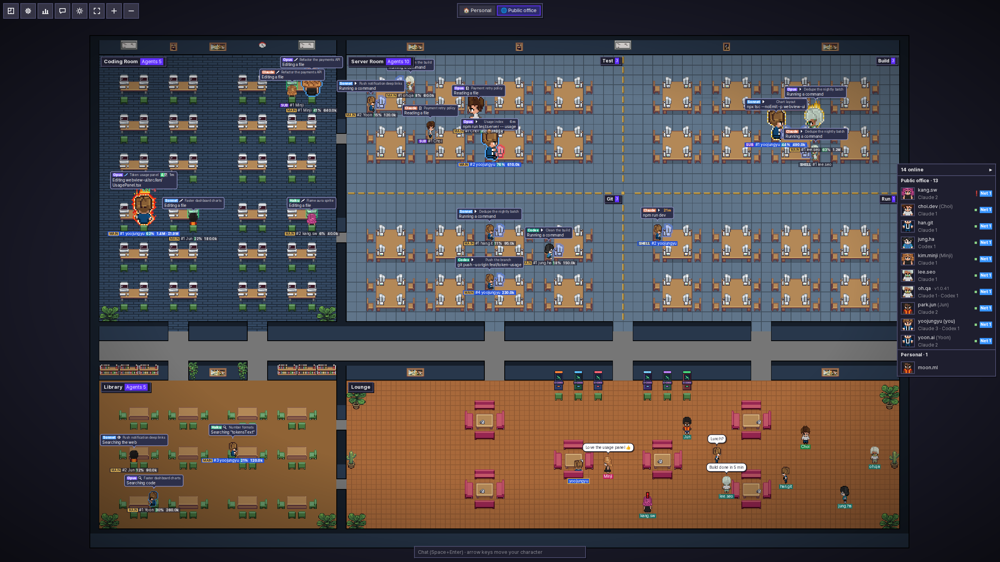

<h1 align="center">Pixel Office</h1>

  <a href="README.md">한국어</a> · <b>English</b>

  Your AI coding agents as characters in a <b>pixel-art office</b>. 
  Alone, with your team, or with everyone.

  <a href="https://yoojungyu.github.io/pixel-office/en.html"><b>📖 Guide (GitHub Pages)</b></a> ·
  <a href="https://yoojungyu.github.io/pixel-office/architecture.html">Architecture (Korean)</a> ·
  <a href="https://github.com/YOOJUNGYU/pixel-office/releases/latest">⬇️ Download</a> ·
  <a href="docs/INSTALL.en.md">Install guide</a>

How to use it, what each look means, token usage, the kinds of office, security and privacy, how it works, known limits and development are all in the **[guide](https://yoojungyu.github.io/pixel-office/en.html)**. The stack, the overall structure and how it is built and shipped are on the **[architecture page](https://yoojungyu.github.io/pixel-office/architecture.html)** (Korean).

The site's source is in [`site/`](site/); a push to `main` republishes it through the [Pages workflow](.github/workflows/pages.yml).

## Credits

- Original project: [pixel-agents](https://github.com/pixel-agents-hq/pixel-agents) (MIT), where the office engine, layout editor, furniture and the wardrobe (character renderer, clothes, blinking) come from.
- Characters: [JIK-A-4, Metro City](https://jik-a-4.itch.io/metrocity-free-topdown-character-pack)
- Token usage: idea and counting rules from [token-dashboard](https://github.com/nateherkai/token-dashboard) (MIT).
- Font: [Pretendard](https://github.com/orioncactus/pretendard) (SIL OFL 1.1)

## License

[MIT](LICENSE). The original pixel-agents copyright notice is kept.
