<h1 align="center">Pixel Office</h1>

<p align="center">
  <a href="README.md">한국어</a> · <b>English</b>
</p>

<p align="center">
  Your AI coding agents as characters in a <b>pixel-art office</b>.<br>
  Alone, with your team, or with everyone.
</p>

<p align="center">
  <a href="https://github.com/YOOJUNGYU/pixel-office/releases/latest"><b>⬇️ Download</b></a> ·
  <a href="docs/INSTALL.en.md">Install guide</a> ·
  <a href="#how-it-works">How it works</a> ·
  <a href="#development">Development</a>
</p>

Pixel Office turns the Claude Code and Codex sessions on your PC into characters in a pixel-art office. Each agent walks to the room that fits what it's doing: the coding room when it edits files, the library when it reads or searches, the server room (split into test, build, git and run zones) when it runs commands, and the lounge when it's done or waiting for you. A bubble over its head says what it's working on. You can run the office alone, share it with your team over the LAN, or join the public office where everyone with the app shows up. There's also a token usage panel, people avatars with chat, a small lounge arcade with a shared hall of fame, a window with each session's full conversation, desktop notifications, a layout editor, and Windows/Mac installers that update themselves. It started as a fork of [pixel-agents](https://github.com/pixel-agents-hq/pixel-agents); the differences are [below](#how-it-differs-from-the-original).

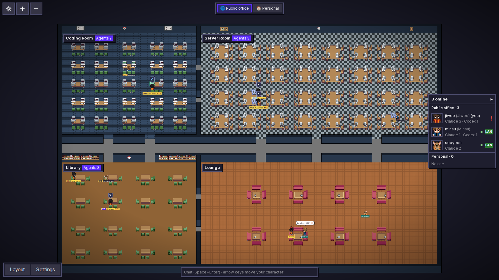

<sub>Made-up data: ten people in the public office. The blue name tags are my agents, so they show their full bubble and token signals. Everyone else's agents show up quiet, without bubbles. People and their chat bubbles hang out in the lounge, and the people panel sits on the right.</sub>

There are three offices, and you can switch between them any time with the buttons at the top:

- 🌐 **Public office** (default): everyone who has the app, on any network. PCs on your network connect directly, the rest through an internet relay.
- 🔒 **Team office**: people who have your invite code, on the same network only.
- 🏠 **Personal**: just your PC. Your agents and chat stay on it.

### How it differs from the original

[pixel-agents](https://github.com/pixel-agents-hq/pixel-agents) (MIT) is a VS Code extension that launches Claude Code agents and shows the ones on your own PC as characters. Pixel Office keeps its office engine, layout editor and furniture, and builds a different app around them.

The token usage feature is modeled on [token-dashboard](https://github.com/nateherkai/token-dashboard). The idea of reading the transcripts into per-day, per-project and per-model totals with a list of the most expensive sessions comes from there, and so does counting a response once even when the transcript logs it several times. No code was copied: it was written from scratch and lives as a panel inside the office instead of a separate dashboard. Codex support, the character size and flames, and opening finished sessions are additions.

|             | pixel-agents                             | Pixel Office                                         |
| ----------- | ---------------------------------------- | ---------------------------------------------------- |
| Form        | VS Code extension                        | Standalone app with installers, tray and auto-update |
| Agents      | Claude Code, launched from the extension | Claude Code and Codex, whatever you already run      |
| Who you see | Your own PC                              | Public office, team office or just you               |
| Office      | Free-form layout                         | Rooms mean activities; layouts are shared            |
| People      | None                                     | Avatars you walk around, chat, a people panel        |
| Status      | Character animation                      | Bubbles, icons, progress, PC screens and effects     |
| Tokens      | None                                     | Usage panel; characters grow and glow with use       |
| Extras      | None                                     | Session windows, notifications, light theme, ko/en   |
| Removed     | None                                     | Launching agents, the terminal, VS Code integration  |

## Install

1. Grab the installer from [Releases](https://github.com/YOOJUNGYU/pixel-office/releases/latest): `PixelOffice-<version>-Windows.exe` for Windows, `PixelOffice-<version>-Mac.pkg` for Mac (Apple silicon and Intel). Node comes bundled, so there's nothing else to install.
2. The installers aren't code-signed, so your OS will complain.
   - **Windows**: on "Windows protected your PC", click More info, then Run anyway, then Yes on the UAC prompt.
   - **Mac**: on "Not Opened", click Done (not Move to Trash). Then go to System Settings → Privacy & Security → Open Anyway and open the pkg again. Or run `sudo installer -pkg <the pkg> -target /` in Terminal. If your firewall is on, allow incoming connections.
3. The office opens in your browser. Pick a character and a colour (a nickname is optional), and a short tour walks you through the rest.

It starts at login by default; you can turn that off in Settings. To quit, use the tray icon's Quit Pixel Office or the same button in Settings. To get back to it, use the tray, the desktop or Start menu shortcut, the Mac Applications folder, or just open `http://localhost:47801`. Updates are automatic (see [More](#more)).

If PCs don't find each other or you want to uninstall, see the [install guide](docs/INSTALL.en.md). If company security software blocks the app, ask IT for an exception.

## Using it

### Rooms

An agent moves once a new activity has lasted about 3 seconds, then takes a free seat. Hover a room's name plate to see what sends agents there and who's inside. The `Agents N` chip counts everyone in the room, subagents and shells included.

| Room           | What sends an agent there                                                                                                |
| -------------- | ------------------------------------------------------------------------------------------------------------------------ |
| 🖥️ Coding Room | Editing files (Claude `Edit`/`Write`, Codex `apply_patch`, shell commands that write files such as `sed -i` or `> file`) |
| 📚 Library     | Reading files, searching code or the web, read-only commands like `rg` or `cat`                                          |
| 🗄️ Server Room | Running commands (`Bash`, the Codex shell) and background shells                                                         |
| 🛋️ Lounge      | Waiting for you or finished. The agent merges into its owner's person character                                          |

The server room has four zones marked with tape on the floor. An agent sits in the zone that matches its command, or anywhere in the room if that zone is full:

- **Test** (top left): vitest, pytest, npm test, e2e and verify scripts, curl, browser checks
- **Build** (top right): tsc, build, lint, installs, codegen, docker, moving files around
- **Git** (bottom left): git, gh, worktrees
- **Run** (bottom right): everything else

Each zone has its own plate with a count. Hover it to see what belongs there.

### Characters

- **Name tags** start with MAIN, SUB or SHELL, then the agent's number and its owner's nickname (or PC account). Your own person character always shows its tag, in the colours you picked, with a yellow frame.
- **Bubbles**: every working agent has one with a Claude or Codex badge and what it's doing. Your own agents also show the session title. Hover a character for the full text. A red **!** means it's waiting for you.
- The bubble also has an icon for the kind of work, task progress like `3/7`, and how long the current step has been running (it turns orange when that gets long). Zoom out far enough and only the icon is left.
- Your own agents' name tags end with how full their context is, like `29%`.
- The office reacts to what's really happening in each session. PC screens show code, a terminal or a page. Working PCs glow. Edits float up as `+12 −3`. A failed tool makes the PC flash red and puff smoke. Finishing a task list or a turn sets off confetti. Server LEDs blink while a command runs.
- **Subagents and shells** sit as close to their parent as they can, or hold its hand if the room is full. In another room they do their own thing. When the parent hands off work or the subagent reports back, the two meet and talk for a moment.
- **Map**: drag to pan, scroll to zoom, or use + and − at the top left.

### Token signals on your agents

Agents also show how many tokens they're using. Size and flames are shared with everyone in the office; the token count, model badge and 📦 are yours alone and never leave your PC. All screenshots below use made-up data.

|                        Screen                        | State               | What you see                                                                                                                                                |
| :--------------------------------------------------: | ------------------- | ----------------------------------------------------------------------------------------------------------------------------------------------------------- |
|  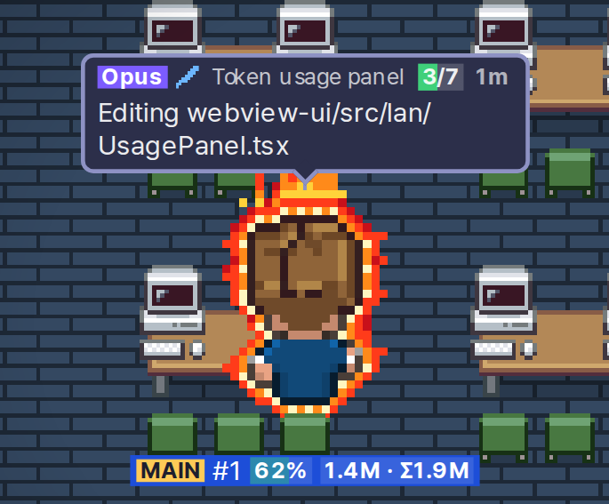  | Heavy and fast      | Over 1M tokens, so it's twice the size, and over 75k a minute, so it has a red flame aura. The tag chip `1.4M · Σ1.9M` is this session, then with subagents |
| 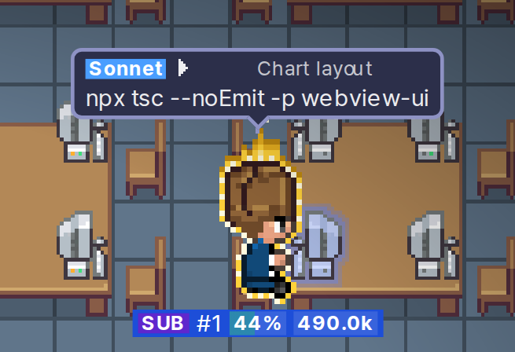  | Medium (a subagent) | Over 300k tokens (1.5×) and 40k a minute (gold flame). Sonnet's badge is blue. The `SUB` tag carries its parent's number                                    |
| 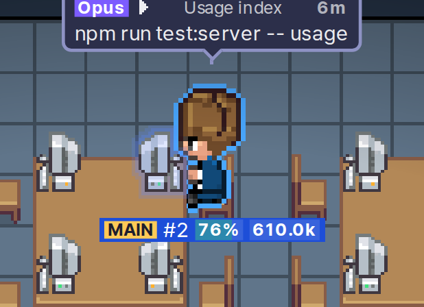  | Slow and steady     | Over 15k a minute gets a blue outline. This one is running tests, so its screen shows a terminal                                                            |
| 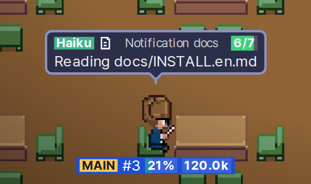 | Light work          | Under 300k tokens and 15k a minute: normal size, no outline. Haiku's badge is green                                                                         |
| 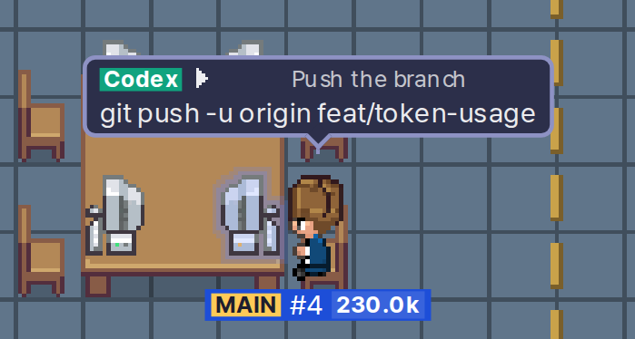 | Codex               | Codex keeps its green badge. Model badges are only for Claude                                                                                               |
|   | Waiting for you     | The agent has merged into your character in the lounge, and the red ! says it needs approval                                                                |
|  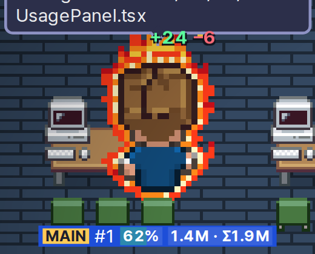  | Edited files        | The changed lines float up as `+24 −6`                                                                                                                      |
|  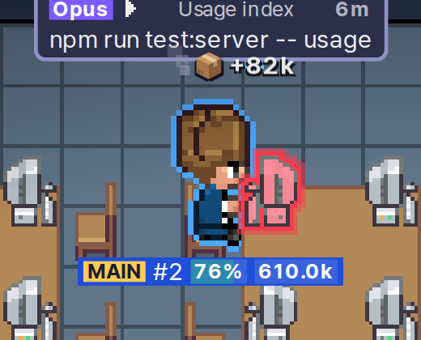  | Big result, failure | A tool result of 50k tokens or more floats up as 📦 +82k. A failed tool flashes the PC red, puffs smoke and leaves a drop by the head                       |
|  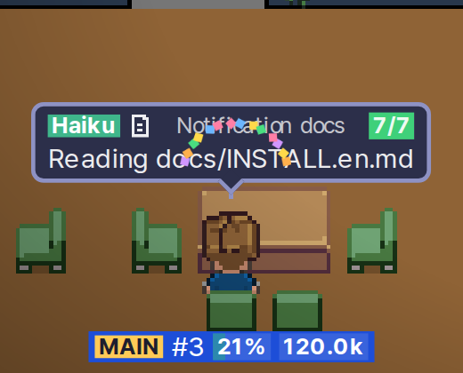  | Task list done      | Confetti when the task list hits `7/7` or a main agent finishes                                                                                             |
|   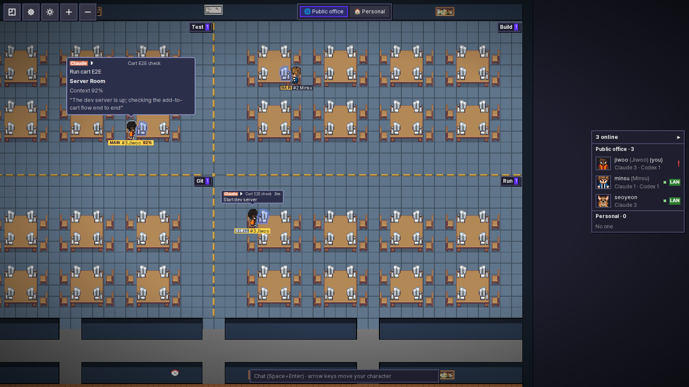   | On hover            | The full picture: activity, room, reason, elapsed time, tasks, changed lines, context, tokens, model and burn rate                                          |

How the numbers work:

- **Size** goes by the session's total tokens: normal under 300k, 1.5× from 300k, 2× from 1M. Just three steps, so the pixels stay crisp.
- **Outline** goes by tokens per minute over the last 2 minutes: blue ring from 15k, low gold flame from 40k, red flame aura from 75k. The red flame looks nothing like a failure (that's a red drop and a blinking PC).
- **Tokens** means input + output + cache writes. Cache reads are left out and shown separately in the usage panel.
- Other people's agents in the public office have no bubble at all, just their room, seat, screen and the !. In a team office you see their bubbles too. Everyone's size and flames show in both offices: other PCs get only the two tiers, never the token counts. A flame stays lit for 30 seconds after the rate drops, so it doesn't flicker at a threshold.

### Token usage (📊)

This one borrows its idea from [token-dashboard](https://github.com/nateherkai/token-dashboard). The 📊 button at the top left opens the usage panel right under the buttons. Drag its right edge, bottom edge or corner to resize it; it remembers the size. Click 📊 again or × to close it.

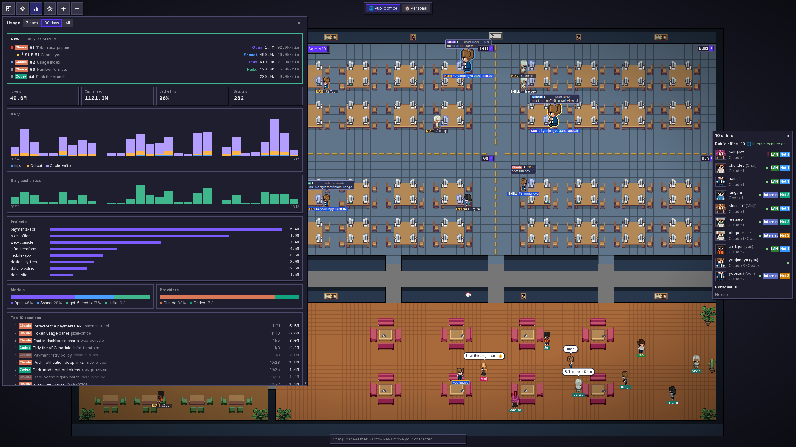

<table><tr>
<td width="50%">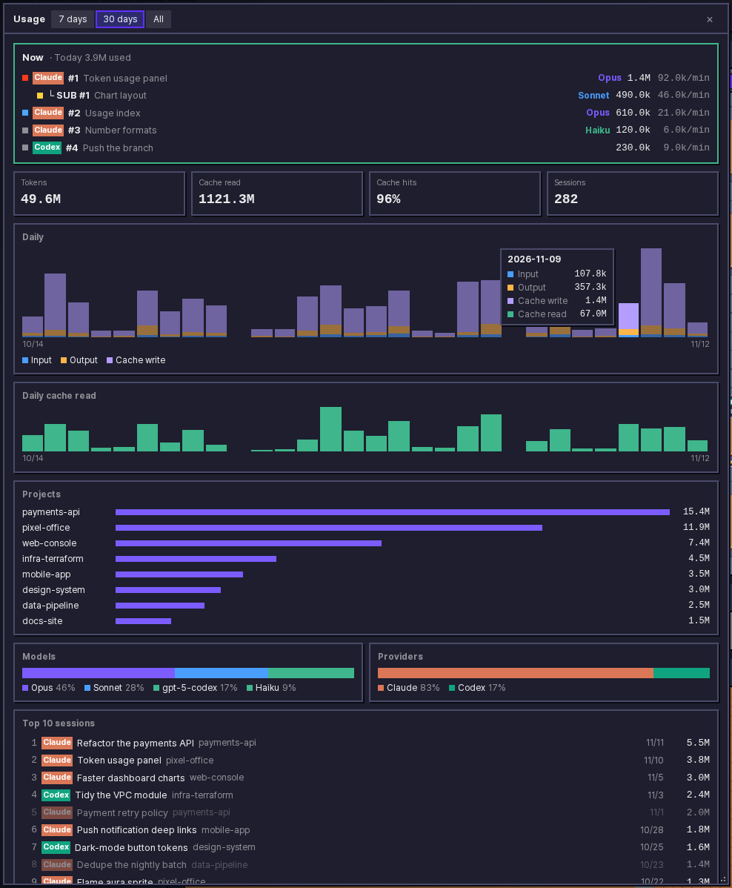</td>
<td width="50%">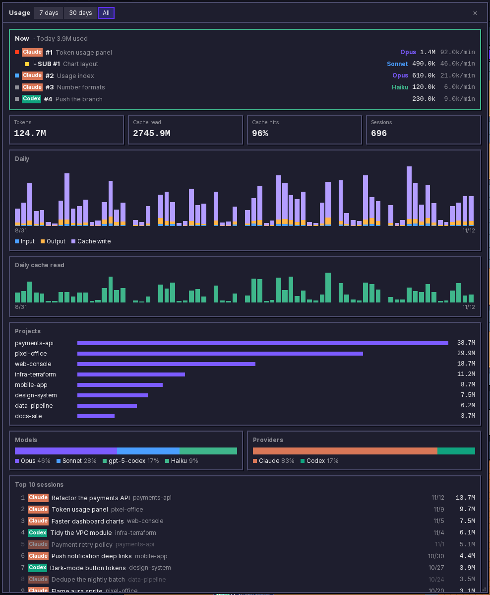</td>
</tr><tr>
<td>Last 30 days. Hover a bar to see that day's input, output, cache writes and cache reads</td>
<td>All history</td>
</tr></table>

- **Now** shows today's tokens and, for each agent working right now, its model, session tokens and tokens per minute. Subagents are indented under their parent. Click a row to open that session.
- **History** covers 7 days, 30 days or everything. You get totals, cache reads and hit rate, daily bars, top projects, the split between models and between Claude and Codex, and the 10 most expensive sessions. Those open even if the session is long over; if its transcript is gone, the row is dimmed.
- The first start reads your whole Claude Code and Codex history once (WSL included) and shows "Scanning history…" while it does. After that it only reads what's new. Only totals are kept, in `~/.pixel-office/usage.json`, with no prompt text, so your numbers survive even when Claude Code deletes old transcripts. Nothing here is sent anywhere.
- A response written to the transcript several times is counted once, the way it's billed. There's no conversion to money.

### Offices

The tabs at the top switch offices: 🏠 Personal, 🌐 Public office, then your 🔒 team. A new install starts in Personal; after that the app reopens the office you used last.

The people panel on the right is split into Public office, Team and Personal, so you can see who's around even in the offices you're not looking at. The Team area only appears once you've joined a team.

**🌐 Public office.** Everyone with the app ends up here, at home, at work or in a café. PCs on the same network find each other directly; the rest go through a Cloudflare relay over one outbound `wss` connection on port 443. There's nothing to set up.

- People in the public office see your account name, nickname, character, chat, and which room your agents are in. They never see what your agents are actually working on: no bubbles, file names, commands or timers. You still see all of that for your own agents.
- The relay fits 20 people at a time. A chip next to the panel's "Public office" title tells you how it's doing: connected, connecting, full, paused for the day, removed by the admin, or no internet. Whatever it says, you stay in the public office. PCs on your network stay visible and the relay reconnects on its own.
- Each person's row shows `LAN` or `Internet` depending on how you're connected. If people are on two or more networks, rows also get a `Net 1` / `Net 2` badge.
- The shared layout travels over the relay too.

**🔒 Team office.** Only people with the invite code (`PO2-…`) on the same network. It never goes over the internet. Create a team, join one or leave in Settings → Offices; creating a team gives you the code to send around. You can be in one team at a time, and joining another replaces it after asking. **While you're in a team office you're not in the public office at all.** You can still see who's there in the people panel, but they can't see you.

**🏠 Personal.** A small office that's just yours. Agents, chat and your avatar's spot stay on your PC. Other people only see a name card for you (account, nickname, character) under Personal in their people panel. Your team membership is kept, so you can switch back without the code.

### Your character and chat

- Everyone has one person character besides their agents. Walk it anywhere with the arrow keys and sit on lounge chairs. It remembers where you left it.
- Type in the chat bar at the bottom and press Enter to put a bubble over your head. A new message replaces the old one and × removes it. There's no history. Messages are up to 100 characters, one every 2 seconds.
- Space+Enter (with nothing focused) jumps to the chat bar. Esc gives the arrow keys back.

### Arcade

Five cabinets stand against the lounge's top wall. Sit on the chair in front of one and its game starts at once, with how to play on the left and the hall of fame on the right. Esc stops; the arrow keys then stand you up.

| Game             | How it plays                                                                               |
| ---------------- | ------------------------------------------------------------------------------------------ |
| Firewall Breaker | Bounce the ball off your paddle to break bricks; tough and steel bricks, power-up capsules |
| Cable Run        | Steer the cable to eat packets and grow; gold bursts, firewalls                            |
| Bug Squash       | Squash bugs popping up on 9 monitors; leave the green patches alone; 45 s                  |
| Drone Delivery   | Space flaps; fly through the gaps between server racks                                     |
| Merge            | Arrow keys slide the tiles; equal numbers merge                                            |

- One player per cabinet. If someone is sitting there you get a "… is playing" notice and can sit once the seat is free.
- The hall of fame keeps each person's best per game, top 50, including people who are offline. People online now get a ●.
- Scores can't be faked: your PC sends the run's inputs, not a score, and the relay replays the game itself to score it.
- Without internet you can still play, but nothing is recorded. M or the 🔊 button mutes the sound.

### Session details

Click one of your own agents to open its whole session in a new window: prompts, replies, tool calls and results. For an agent resting in the lounge, click your own character and pick it from the list. A shell shows its command's output instead. This only works for your agents, and none of it leaves your PC.

Each agent gets one window; clicking again brings it to the front. Under the status line there's a strip of the last 30 minutes, one cell per minute, coloured by what happened (edit, command, read, thinking, failure). The status line also shows how full the context is, like `294k / 1M · 29%`, turning orange at 80%. The slider in the header zooms the text. Close with × or Esc.

### People panel and notifications

The panel on the right lists everyone in the current office, with or without agents. Click a name to jump to their agents. If someone runs a different version, it shows after their name, like ` · v1.0.41`.

Pixel Office can also send desktop notifications on Windows and Mac. They work with the window closed as long as the tray icon is running, and you can turn each kind off in Settings:

- **Join and leave**: someone enters or leaves the public office.
- **Your agents**: a Claude or Codex session is waiting for you or has finished. "Finished" only fires when the main agent ends its own turn and all its subagents and shells are done. A subagent finishing on its own never triggers it. The notification includes the session title and project folder.
- **Chat**: someone in the office you're viewing posts a new bubble. Bubbles that were already up, or that someone had when they came online, don't count.

### More

- **Profile**: pick a character (six people, or the pets Claudio and Gitcat), a colour, a nickname and your name tag colours. Your PC account name always comes first and can't be changed. Nicknames are unique; whoever took one second gets a short suffix like `· a1b2`.
- **Language and theme**: Korean or English, dark, light or system, set per browser. The sun/moon button at the top left flips the theme.
- **Layout editor**: the Layout button at the top left. You can paint floors (a click fills a whole room, or one zone in the server room), recolour walls, place furniture and fill the background. The four rooms and the office size are fixed, and so are desks, chairs, PCs and arcade cabinets (they keep the office working): you can recolour them but not move or remove them. When a new version changes the default layout, those pieces update in your saved layout by themselves.
  - Nothing is saved until you press **Save**. Reset brings back the default layout, Undo and Redo are Ctrl+Z and Ctrl+Y, and Cancel or Esc drops your changes.
  - In the public office or a team office, anyone can edit and everyone there gets the saved layout. If two people save, the last one wins. A layout saved per PC by older versions (`layout.json`) isn't used anymore; import it if you want to share it.
  - In 🏠 Personal the layout stays on your PC.
  - Settings has Export and Import if you want a layout as a file.
- **Install as an app**: Edge and Chrome offer it in a popup at the top right. You get a window without tabs. If you open it while the server is off, it shows a Start button.
- **Automatic updates**: Pixel Office checks at start and every 6 hours, downloads quietly, restarts into the new version and reloads open windows. You can't turn this off. If a new version fails to start, it rolls back. The rare release that changes the bundled Node needs the installer, and an Update button shows up at the top right for that.
- **Replay the tour** from Settings.

## Security and privacy

- PCs only share status. Nobody can reach your terminal, your agents or your settings, and the UI only opens in your own PC's browser.
- Everything between PCs is encrypted. In the public office each pair of PCs agrees on its own key (X25519, then AES-256-GCM). A team office uses AES-256-GCM with a key derived from the invite code. Codes never go over the network, and a known PC whose key suddenly changes is ignored.
- The relay only forwards encrypted messages. It sees peer ids, public keys and who a message is for. It doesn't store IP addresses; it only keeps a hashed tag for the network badge. Cloudflare, which hosts it, does see your IP. Everyone in the public office can see where your avatar is and where it walks. Team and personal PCs never connect to the relay for the office; the arcade is the one exception, from any office: it sends your peer id and display name (account and nickname) to the relay to keep your scores.
- File paths, user names, IPs and host names, URL paths, anything that looks like a token, and AI reply text never leave your PC. Commands go out as just the program name. Your PC account name is your name tag, so that one is always visible.
- The public office only gets your agents' room, kind of work and the waiting !. A team office gets more detail, like program and file names, within the rules above.
- Pixel Office never touches your Claude Code or Codex settings. It only reads their transcript files.

## How it works

```
 [My PC]                                         [Colleague's PC]
 Claude / Codex transcripts ─▶ reporter ─┐    ┌─ reporter ◀─ transcripts
  (~/.claude, ~/.codex, WSL)             │ enc │
                                         ├◀───▶┤   UDP status every second (same network)
                                         └◀ wss ▶ Cloudflare relay ▶ public-office PCs on other networks
 browser ◀── WebSocket ── local server ◀─┘    └▶ local server ── WebSocket ──▶ browser
 (app window) http://localhost:47801                 http://localhost:47801 (app window)
```

- The reporter watches sessions under `~/.claude/projects` and `~/.codex/sessions` that changed in the last 30 minutes. On Windows it also checks running WSL distros. A closed Claude session disappears within seconds, or after 30 minutes if its process can't be checked. A finished Codex session leaves after 10 minutes.
- On the same network, a PC that goes quiet for 5 seconds disappears. Over the relay, a PC stays until the relay says it left, which happens after 90 seconds of silence.
- Your personal layout never leaves your PC. Shared layouts only go to people in that office.
- All data lives in `~/.pixel-office/`. Files with keys and codes are readable only by you (0600).

| Port      | Purpose                                                         |
| --------- | --------------------------------------------------------------- |
| UDP 47800 | Status between PCs (broadcast + IPs you add)                    |
| TCP 47801 | Browser UI (`127.0.0.1` only)                                   |
| TCP 443   | **Outbound** `wss` to the public-office relay (nothing inbound) |

## Known limits

- Broadcasts don't cross subnets. If a PC on another floor or VLAN doesn't show up, add its IP in Settings → My profile → Advanced.
- Anyone who installs the app can join the public office. If you want to choose who's in, use a team office. The admin can remove someone, but bans are per peer id, so deleting `profile.json` gets around them.
- If a corporate proxy or firewall blocks outbound `wss` on 443, the internet part fails and the chip says there's no connection. PCs on your network still show up. Ask IT for an exception instead of working around it.
- The relay runs on Cloudflare's free tier: 20 people at once, and it pauses for the day at 95% of the daily limit. It resets at 00:00 UTC (09:00 KST). Your local network isn't affected.
- Whoever runs the relay could swap a public key the first time two PCs meet and read that pair's traffic. There's no key fingerprint screen yet.
- Codex doesn't log approval requests, so the ! only shows up for Codex when it asks you a question.
- Redaction can miss a password typed straight into a command or search.
- Older versions miss some things: 0.4.x doesn't show PCs with lots of agents or pets, 1.0.0 and older don't show people or chat, and 1.0.13 and older don't get shared layouts. 1.0.24 and older may not list personal-mode PCs. Get everyone on the latest version.
- On Mac, notifications may show up as coming from "Script Editor". Linux and WSL have no tray icon or notifications.

## Development

```bash
npm install
npm run build              # dist/ — cli.js bundles its dependencies (runs without node_modules)
node dist/cli.js --open    # http://localhost:47801
npm test                   # server + webview (Vitest)
npm run check-types && npm run lint
```

- Code structure and conventions are in [CLAUDE.md](CLAUDE.md). Design docs and plans are in [docs/superpowers/](docs/superpowers/).
- To release, bump `version` in `package.json` and push a `v<version>` tag. GitHub Actions builds the Windows and Mac installers plus the auto-update bundle and publishes a Release. A tag containing `-` is a prerelease. A full release deletes the older ones.

## Credits

- Original project: [pixel-agents](https://github.com/pixel-agents-hq/pixel-agents) (MIT), where the office engine, layout editor and furniture come from.
- Characters: [JIK-A-4, Metro City](https://jik-a-4.itch.io/metrocity-free-topdown-character-pack)
- Token usage: idea and counting rules from [token-dashboard](https://github.com/nateherkai/token-dashboard) (MIT).
- Font: [Pretendard](https://github.com/orioncactus/pretendard) (SIL OFL 1.1)

<p align="center">
  
</p>

## License

[MIT](LICENSE). The original pixel-agents copyright notice is kept.
