<h1 align="center">Pixel Office</h1>

<p align="center">
  <b>한국어</b> · <a href="README.en.md">English</a>
</p>

<p align="center">
  AI 코딩 에이전트가 픽셀 사무실의 캐릭터가 되어 일하는 모습을 보여 주는 앱입니다.<br>
  혼자 써도 되고, 팀이나 다른 사람들과 같이 봐도 됩니다.
</p>

<p align="center">
  <a href="https://github.com/YOOJUNGYU/pixel-office/releases/latest"><b>⬇️ 설치 파일 받기</b></a> ·
  <a href="docs/설치-안내.md">설치 안내</a> ·
  <a href="#동작-방식">동작 방식</a> ·
  <a href="#개발">개발</a>
</p>

내 PC에서 돌고 있는 Claude Code와 Codex 세션을 읽어서, 에이전트 하나하나를 사무실 캐릭터로 보여 줍니다. 파일을 고치면 코딩실, 뭔가 찾아보면 자료실, 명령을 돌리면 서버실로 걸어가 앉고, 머리 위 말풍선과 PC 화면을 보면 지금 무슨 일을 하는지 알 수 있습니다. 사무실은 누구나 들어오는 공개 오피스, 초대 코드로 들어오는 팀 오피스, 나 혼자 쓰는 개인용 중에서 고르면 됩니다. 📊 버튼을 누르면 토큰을 얼마나 썼는지 볼 수 있고, 토큰을 많이 쓴 에이전트는 몸집이 커지고 빨리 쓰는 에이전트는 몸에 불꽃이 붙습니다. 그 밖에 사람 캐릭터와 채팅, 세션 대화를 통째로 보는 창, 응답을 기다리거나 일이 끝났을 때 오는 알림, 레이아웃 편집이 있고, Windows·Mac 설치 파일로 깔면 알아서 업데이트됩니다.

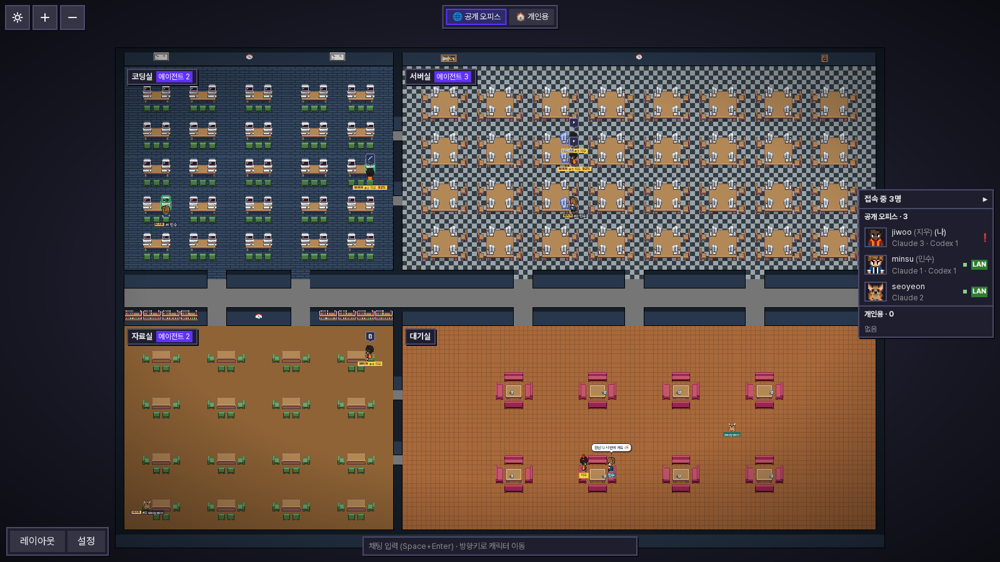

<sub>가상 데이터로 만든 화면입니다. 공개 오피스에 10명이 들어와 있고, 에이전트들이 방마다 흩어져 일하고 있습니다. 파란 이름표가 내 에이전트인데, 내 것만 크기와 불꽃, 토큰 수, 말풍선이 보입니다. 다른 사람 에이전트는 공개 오피스에서는 말풍선 없이 어느 방에 있는지만 보입니다. 대기실에는 사람 캐릭터들이 채팅을 하고 있고, 빨간 !는 승인을 기다린다는 뜻입니다. 오른쪽은 접속자 목록입니다.</sub>

## 원작과 다른 점

[pixel-agents](https://github.com/pixel-agents-hq/pixel-agents)(MIT)를 가져와 고친 프로젝트입니다. 원작은 VS Code 확장이라 VS Code 안에서 Claude Code를 실행하고, 내 PC의 에이전트만 캐릭터로 보여 줍니다. 사무실을 그리는 엔진, 레이아웃 편집기, 가구 그림은 원작 것을 그대로 씁니다.

토큰 사용량 기능은 [token-dashboard](https://github.com/nateherkai/token-dashboard)를 참고했습니다. 대화 기록을 읽어 날짜·프로젝트·모델별로 집계하고 비싼 세션을 뽑아 보여 주는 아이디어와, 같은 응답이 여러 줄로 남을 때 한 번만 세는 방식을 가져왔습니다. 코드는 가져오지 않고 새로 짰고, 따로 띄우는 대시보드 대신 사무실 안 패널로 넣었습니다. Codex 집계, 캐릭터 크기와 불꽃, 끝난 세션의 대화 열기는 여기서 더한 것입니다.

|           | 원작 pixel-agents              | Pixel Office                                                   |
| --------- | ------------------------------ | -------------------------------------------------------------- |
| 형태      | VS Code 확장                   | 따로 설치하는 앱 (브라우저 창, 트레이, 자동 업데이트)          |
| 에이전트  | Claude Code를 확장 안에서 실행 | Claude Code와 Codex. 직접 실행하지 않고 대화 기록을 읽기만 함  |
| 누가 보나 | 나만                           | 나 혼자, 같은 망의 팀, 인터넷의 모두 중에서 선택               |
| 사무실    | 자리를 자유롭게 배치           | 하는 일에 따라 방이 정해짐, 같은 오피스 사람들과 배치를 공유   |
| 사람      | 없음                           | 사람 캐릭터, 채팅, 접속자 목록                                 |
| 상태 표시 | 캐릭터 동작                    | 말풍선, 아이콘, 걸린 시간, 할 일 진행, PC 화면, 폭죽 같은 효과 |
| 토큰      | 없음                           | 사용량 패널, 캐릭터 크기와 불꽃                                |
| 그 밖에   |                                | 세션 대화 창, PC 알림, 라이트 테마, 한국어/영어                |
| 뺀 것     |                                | 에이전트 실행, 터미널, VS Code 확장                            |

## 설치

1. [Releases](https://github.com/YOOJUNGYU/pixel-office/releases/latest)에서 내 OS에 맞는 파일을 받습니다. Windows는 `PixelOffice-<버전>-Windows.exe`, Mac은 `PixelOffice-<버전>-Mac.pkg`입니다(Apple 칩, Intel 둘 다 됨). Node가 들어 있어서 따로 깔 건 없습니다.
2. 코드 서명을 안 해서 설치할 때 경고가 뜹니다.
   - Windows: "Windows의 PC 보호" 창에서 **추가 정보** → **실행**을 누르고, 사용자 계정 컨트롤에서 **예**.
   - Mac: "열지 않음" 창이 뜨면 휴지통 말고 **완료**를 누르세요. 그다음 **시스템 설정 → 개인정보 보호 및 보안**에서 **그래도 열기**를 누르고 pkg를 다시 엽니다. 터미널이 편하면 `sudo installer -pkg <받은 pkg> -target /`. 방화벽이 켜져 있으면 들어오는 연결을 허용해 주세요.
3. 설치가 끝나면 브라우저에 사무실이 열립니다. 캐릭터와 색을 고르면(닉네임은 안 정해도 됨) 사용법 안내가 이어서 나옵니다.

로그인하면 자동으로 켜집니다. 이건 **설정 → 로그인할 때 자동 실행**에서 끌 수 있습니다. 앱을 끄려면 트레이 아이콘에서 **Pixel Office 종료**를 누르거나 **설정 → 완전 종료**를 누르세요. 다시 열 때는 트레이, 바탕화면이나 시작 메뉴 바로가기, Mac의 응용 프로그램 폴더, 아니면 그냥 `http://localhost:47801`로 들어가면 됩니다.

다른 PC가 안 보이거나 지우는 방법이 궁금하면 [설치 안내](docs/설치-안내.md)를 보세요. 회사 보안 프로그램이 막는다면 IT 담당자에게 예외 등록을 부탁해야 합니다.

## 사용법

### 방마다 하는 일이 다릅니다

에이전트는 같은 종류의 일을 3초쯤 계속하면 그 방으로 걸어가서 빈자리에 앉습니다. 잠깐씩 바뀌는 일 때문에 왔다 갔다 하지 않게 하려고 이렇게 했습니다.

| 방        | 언제 가나                                                                         |
| --------- | --------------------------------------------------------------------------------- |
| 🖥️ 코딩실 | 파일을 고칠 때 (Claude `Edit`/`Write`, Codex `apply_patch`)                       |
| 📚 자료실 | 파일을 읽거나 코드·웹을 검색할 때 (Codex의 `rg`, `cat`, `git log` 같은 명령 포함) |
| 🗄️ 서버실 | 명령을 실행할 때, 백그라운드 셸                                                   |
| 🛋️ 대기실 | 입력이나 승인을 기다릴 때, 일을 마쳤을 때                                         |

서버실은 바닥 테이프로 네 구역이 나뉘어 있어서 명령 종류에 맞는 구역에 앉습니다. 왼쪽 위는 테스트(vitest, pytest, npm test, curl 등), 오른쪽 위는 빌드(tsc, lint, 패키지 설치, docker 등), 왼쪽 아래는 Git, 오른쪽 아래는 나머지 명령입니다. 구역이 꽉 차면 서버실 안의 다른 빈자리로 갑니다.

대기실은 사람 자리라서, 여기로 돌아온 에이전트는 따로 보이지 않고 그 PC 주인의 사람 캐릭터에 합쳐집니다.

방 이름표에 마우스를 올리면 어떤 일로 그 방에 오는지와 지금 그 방에 있는 에이전트들이 보입니다. 이름표 옆 `에이전트 3` 같은 숫자는 서브에이전트와 셸까지 센 겁니다.

### 캐릭터 읽는 법

캐릭터 아래에는 이름표가 있습니다. `MAIN`은 메인 에이전트, `SUB`는 서브에이전트, `SHELL`은 백그라운드 셸이고, 그 뒤에 `#번호`와 주인 이름이 붙습니다. 서브에이전트와 셸은 부모 번호를 따라갑니다.

일하는 에이전트 머리 위에는 말풍선이 뜹니다. 맨 윗줄에 Claude인지 Codex인지, 무슨 일을 하는지 아이콘, 세션 제목, 할 일 진행(`3/7`), 지금 일을 시작하고 몇 분 지났는지가 나오고, 그 아래에 하는 일이 적혀 있습니다. 오래 걸리면 시간이 주황색으로 바뀝니다. 마우스를 올리면 전체 내용이 다 보입니다. 머리 위에 빨간 !가 뜨면 승인이나 답을 기다리는 중입니다.

그 밖에 이런 것들도 보입니다.

- 에이전트가 앉은 PC 화면이 하는 일에 따라 바뀝니다. 코드를 고치면 초록 코드, 명령을 돌리면 검은 터미널, 뭔가 읽으면 흰 문서 화면입니다.
- 파일을 고치면 머리 위로 `+12 −3`처럼 바꾼 줄 수가 떠오릅니다.
- 도구가 실패하면 PC가 빨갛게 깜빡이고 연기가 납니다.
- 할 일을 다 끝내거나 일을 마치면 폭죽이 터집니다.
- 서버실에서 명령이 돌고 있으면 서버 PC의 LED가 깜빡입니다.
- 내 에이전트 이름표 끝에는 컨텍스트를 얼마나 썼는지(`29%`)가 붙습니다.
- 화면을 많이 축소하면 말풍선 대신 아이콘만 보입니다.

서브에이전트와 셸은 부모와 같은 방에 있으면 부모 옆 빈자리에 앉습니다. 부모가 서브에이전트에게 일을 맡기거나 서브에이전트가 결과를 보고할 때는 둘이 마주 보고 잠깐 이야기를 나눕니다.

지도는 드래그로 옮기고 휠로 확대·축소합니다. 왼쪽 위 + / − 버튼도 있습니다.

### 상태별 모습

아래는 모두 가상 데이터로 찍은 화면입니다. 크기, 불꽃, 토큰 수, 모델 배지, 📦는 내 에이전트에만 보이고 다른 PC로는 보내지 않습니다.

|                         화면                         | 상태                      | 설명                                                                                                                                                                                                                                   |
| :--------------------------------------------------: | ------------------------- | -------------------------------------------------------------------------------------------------------------------------------------------------------------------------------------------------------------------------------------- |
|  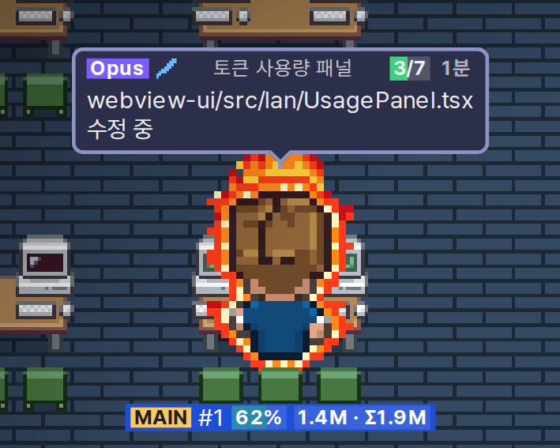  | 토큰을 많이, 빨리 쓰는 중 | 이 세션에서 100만 토큰 넘게 써서 2배 크기가 됐고, 1분에 7만 5천 토큰 넘게 쓰고 있어서 빨간 불꽃이 붙었습니다. 이름표 끝 `1.4M · Σ1.9M`은 이 세션이 쓴 토큰과 서브에이전트까지 합친 토큰입니다. 보라색 배지는 Opus 모델이라는 뜻입니다. |
| 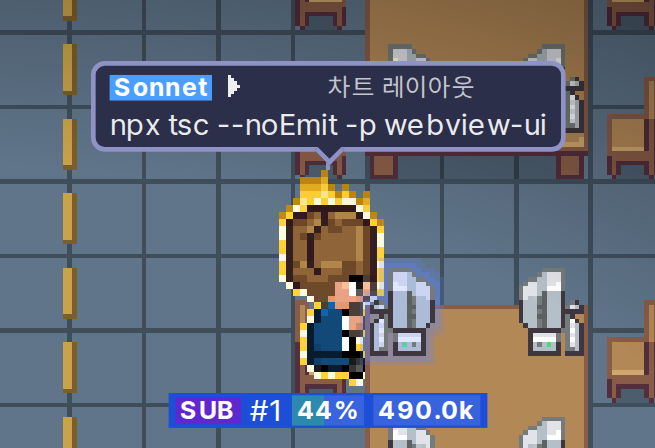  | 꽤 빨리 쓰는 중           | 30만 토큰을 넘어서 1.5배, 1분에 4만 토큰 넘게 써서 노란 불꽃이 낮게 붙었습니다. 이 캐릭터는 서브에이전트이고, 파란 배지는 Sonnet입니다.                                                                                                |
| 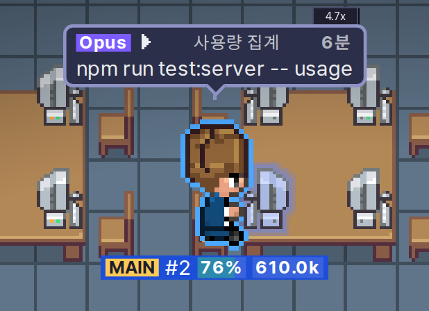  | 꾸준히 쓰는 중            | 1분에 1만 5천 토큰을 넘으면 파란 테두리가 생깁니다. 서버실 테스트 구역에서 명령을 돌리고 있어서 PC 화면이 터미널입니다.                                                                                                                |
| 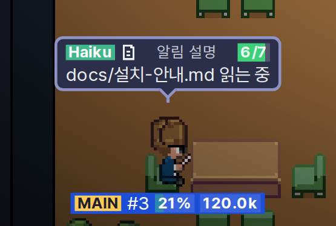 | 가볍게 일하는 중          | 토큰을 많이 안 썼으면 원래 크기에 테두리도 없습니다. 초록 배지는 Haiku이고, 파일을 읽는 중이라 PC에 문서 화면이 떠 있습니다.                                                                                                           |
| 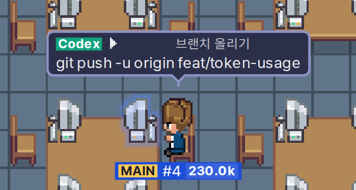 | Codex                     | Codex 세션은 초록색 Codex 배지가 붙습니다. 지금은 서버실 Git 구역에 있습니다.                                                                                                                                                          |
|   | 승인 기다리는 중          | 대기실로 돌아온 에이전트는 내 사람 캐릭터에 합쳐지는데, 승인을 기다리면 사람 머리 위에 빨간 !가 뜹니다.                                                                                                                                |
|  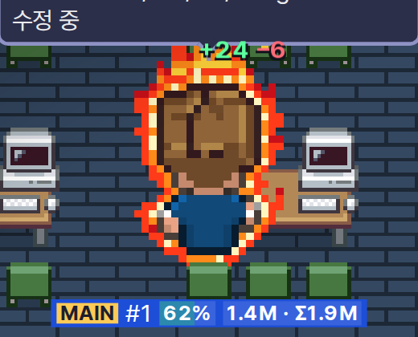  | 파일 수정                 | 바꾼 줄 수가 `+24 −6`처럼 떠오릅니다.                                                                                                                                                                                                  |
|  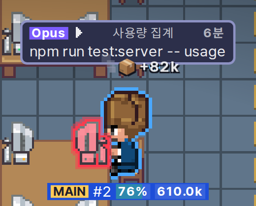  | 결과가 크거나 실패        | 도구 결과가 5만 토큰을 넘으면 `📦 +82k`가 떠오릅니다. 도구가 실패하면 PC가 빨갛게 깜빡이고 연기가 나며, 머리 옆에 물방울이 맺힙니다.                                                                                                   |
|  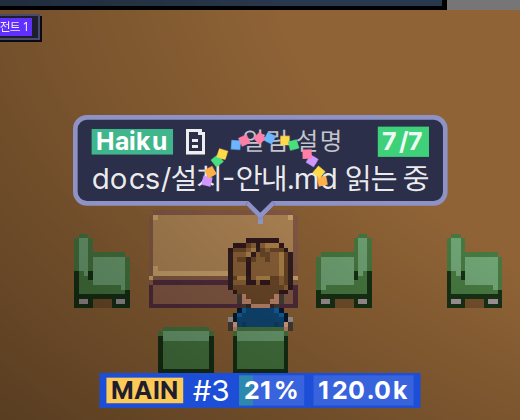  | 할 일 완료                | 할 일 목록을 다 끝내거나 메인 에이전트가 일을 마치면 폭죽이 터집니다.                                                                                                                                                                  |
|   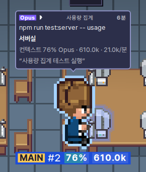   | 마우스를 올렸을 때        | 하는 일 전체와 방, 이유, 걸린 시간, 할 일, 바꾼 줄 수, 컨텍스트, 토큰, 모델, 분당 사용량이 한꺼번에 보입니다.                                                                                                                          |

크기와 불꽃의 기준은 이렇습니다.

- 크기는 그 세션이 지금까지 쓴 토큰으로 정합니다. 30만이 넘으면 1.5배, 100만이 넘으면 2배입니다. 픽셀이 뭉개지지 않게 세 단계만 둡니다.
- 불꽃은 최근 2분 동안 1분에 쓴 토큰으로 정합니다. 1만 5천이 넘으면 파란 테두리, 4만이 넘으면 노란 불꽃, 7만 5천이 넘으면 빨간 불꽃입니다.
- 여기서 토큰은 입력, 출력, 캐시 쓰기를 더한 값입니다. 캐시 읽기는 양이 워낙 커서 빼고, 사용량 패널에서 따로 보여 줍니다.

다른 사람의 에이전트는 공개 오피스에서는 말풍선 없이 어느 방에 있는지, PC 화면, !만 보입니다. 팀 오피스에서는 말풍선까지 보이지만 크기나 불꽃은 보이지 않습니다.

### 토큰 사용량 (📊)

[token-dashboard](https://github.com/nateherkai/token-dashboard)에서 아이디어를 얻은 기능입니다. 왼쪽 위 📊 버튼을 누르면 버튼 바로 아래에 사용량 패널이 열립니다. 오른쪽 끝, 아래 끝, 오른쪽 아래 모서리를 잡아 끌면 크기를 바꿀 수 있고, 바꾼 크기는 기억해 둡니다. 다시 누르거나 ×를 누르면 닫힙니다.

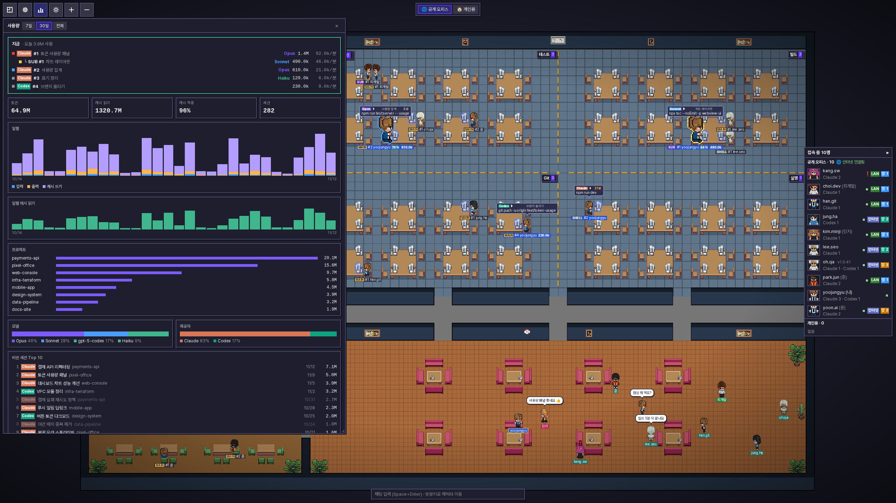

<table><tr>
<td width="50%">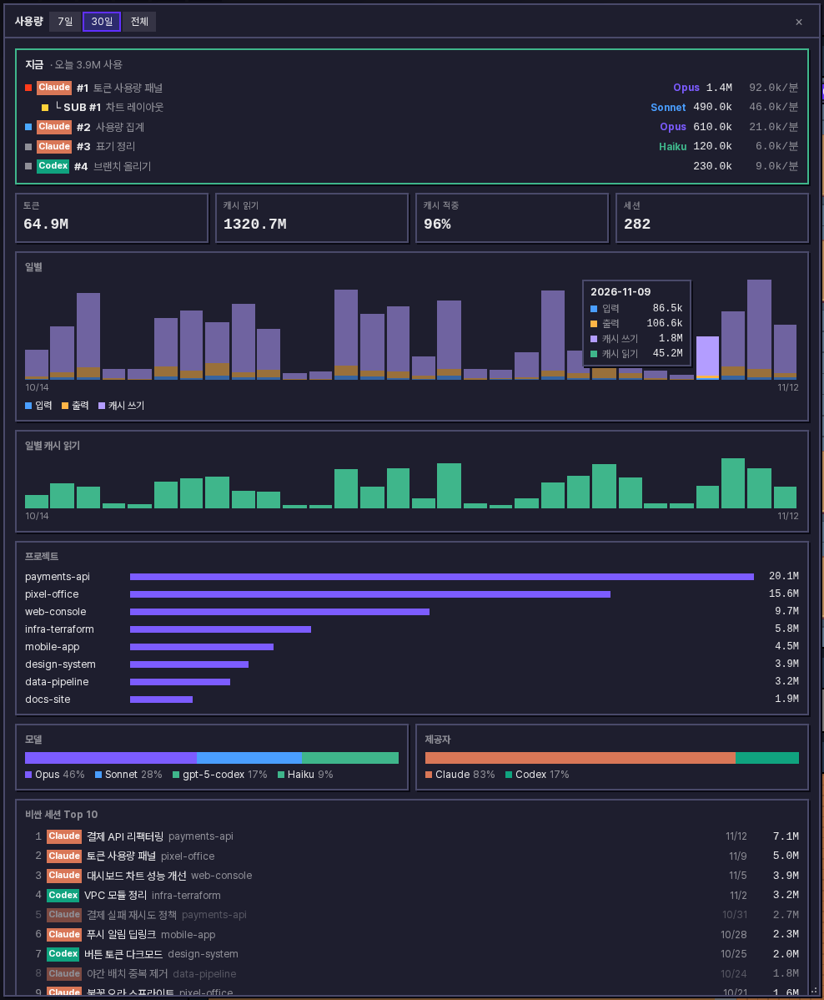</td>
<td width="50%">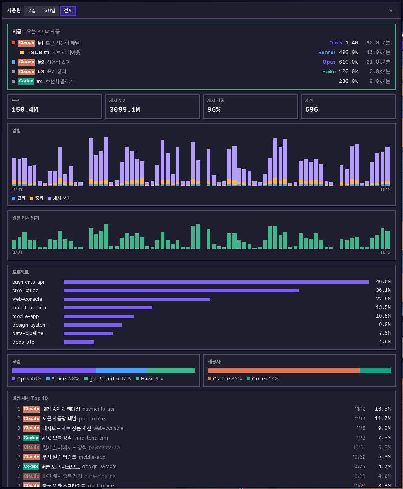</td>
</tr><tr>
<td>최근 30일. 막대에 마우스를 올리면 그날 쓴 양이 종류별로 나옵니다.</td>
<td>전체 기록</td>
</tr></table>

위쪽 "지금"에는 오늘 자정부터 쓴 토큰과, 지금 일하고 있는 내 에이전트별 토큰·모델·분당 사용량이 나옵니다. 줄을 누르면 그 세션의 대화 창이 열립니다.

아래쪽 기록은 7일, 30일, 전체 중에서 고릅니다. 날짜별 막대 그래프, 캐시 읽기, 프로젝트별 순위, 모델별 비중, 그리고 토큰을 가장 많이 쓴 세션 10개가 나옵니다. 이미 끝난 세션도 누르면 대화를 볼 수 있습니다. 기록 파일이 지워진 세션은 흐리게 표시됩니다.

집계는 이렇게 합니다.

- Claude Code와 Codex 대화 기록을 모두 읽어서(WSL 포함) 숫자만 `~/.pixel-office/usage.json`에 모아 둡니다. 프롬프트 내용은 저장하지 않습니다.
- Claude Code가 오래된 기록을 지워도 모아 둔 숫자는 남습니다.
- 처음 켤 때 한 번 전부 읽고("기록 스캔 중…"), 그 뒤로는 새로 늘어난 부분만 읽습니다.
- 같은 응답이 기록에 여러 줄로 남아도 한 번만 셉니다. 금액으로 바꿔 보여 주지는 않습니다.
- 이 PC에서만 보이고 다른 PC로는 보내지 않습니다.

### 오피스 고르기

화면 맨 위 버튼으로 언제든 바꿀 수 있습니다.

🌐 **공개 오피스**가 기본입니다. 앱을 설치한 사람이면 집이든 회사든 카페든 누구나 같은 공개 오피스에 들어옵니다. 같은 망에 있으면 바로 연결되고, 다른 망이면 Cloudflare 중계를 거칩니다. 따로 설정할 건 없습니다.

공개 오피스에서는 계정 이름, 닉네임, 캐릭터, 채팅, 에이전트가 어느 방에 있는지가 모두에게 보입니다. 하지만 에이전트가 무슨 파일을 고치는지, 어떤 명령을 돌리는지 같은 작업 내용은 보이지 않습니다. 내 에이전트는 내 화면에서만 자세히 보입니다.

중계 서버는 무료 요금제라 동시에 20명까지 들어올 수 있습니다. 접속자 목록의 "공개 오피스" 제목 옆에 인터넷 연결 상태가 나오는데, 사람이 꽉 찼거나 하루 사용량을 다 썼거나 인터넷이 막혀 있으면 그 이유가 뜹니다. 그래도 공개 오피스에서 빠지지는 않고, 같은 망 사람들은 계속 보이며, 문제가 풀리면 알아서 다시 연결합니다. 접속자 목록에는 사람마다 `LAN`(같은 망) 또는 `인터넷`(중계) 표시가 붙고, 망이 여럿이면 `망 1`, `망 2`로 같은 망 사람끼리 묶어 보여 줍니다.

🔒 **팀 오피스**는 초대 코드(`PO2-…`)를 아는 사람끼리, 같은 망에서만 씁니다. 인터넷으로는 나가지 않습니다. **설정 → 오피스**에서 팀을 만들고 코드를 팀원에게 전해 주면 됩니다. 팀은 한 번에 하나만 들어갈 수 있습니다. 팀 오피스에 들어가 있는 동안은 공개 오피스에서 내 모습이 사라진다는 점도 알아 두세요.

🏠 **개인용**은 나 혼자 쓰는 작은 사무실입니다. 에이전트, 채팅, 캐릭터 위치가 다른 PC로 나가지 않고, 다른 사람 접속자 목록에 이름만 보입니다. 팀에서 나가는 게 아니라서 나중에 코드 없이 팀으로 돌아갈 수 있습니다.

### 내 캐릭터와 채팅

에이전트와 따로, 사람마다 캐릭터가 하나씩 있습니다. 방향키로 어느 방이든 걸어 다닐 수 있고, 대기실 의자에는 앉을 수도 있습니다. 위치는 앱을 다시 켜도 그대로입니다.

화면 아래 가운데 채팅창에 쓰고 Enter를 누르면 내 캐릭터 머리 위에 말풍선이 뜹니다. 한 사람에 말풍선 하나라서 새로 쓰면 바뀌고, ×로 지울 수 있습니다. 대화 기록은 남지 않습니다. 100자까지, 2초에 한 번 보낼 수 있습니다. 아무것도 선택하지 않은 상태에서 Space+Enter를 누르면 채팅창으로 가고, Esc를 누르면 다시 방향키로 캐릭터를 움직일 수 있습니다.

### 세션 대화 보기

내 에이전트 캐릭터를 누르면 그 세션의 대화 전체가 새 창으로 열립니다. 질문, 답변, 도구 호출, 결과까지 다 나옵니다. 대기실에 합쳐진 에이전트는 내 사람 캐릭터를 누르면 목록이 나오니 거기서 고르면 됩니다. 셸을 누르면 그 명령의 출력이 보입니다.

창 위쪽에는 지금 상태와 컨텍스트 사용량(`294k / 1M · 29%`)이 있고, 그 아래 띠에는 최근 30분 동안 무슨 일을 했는지 1분 단위로 색칠돼 있습니다. 슬라이더로 글자 크기를 바꿀 수 있고, ×나 Esc로 닫습니다. 다른 사람의 에이전트는 열 수 없습니다.

### 접속자 목록과 알림

오른쪽 접속자 목록에는 이 오피스에 들어와 있는 사람이 에이전트가 있든 없든 다 나옵니다. 이름을 누르면 그 사람의 에이전트 쪽으로 화면이 따라갑니다. 나와 앱 버전이 다른 사람은 이름 뒤에 버전이 붙습니다.

앱 창을 닫아도 트레이가 떠 있으면 PC 알림이 옵니다. 설정에서 종류별로 끌 수 있습니다.

- 공개 오피스에 누가 들어오거나 나갔을 때
- 내 에이전트가 답을 기다리거나 일을 마쳤을 때. 서브에이전트나 셸이 끝났을 때는 알리지 않고, 메인 에이전트까지 완전히 끝났을 때만 알립니다.
- 누가 새로 채팅을 올렸을 때

### 그 밖에

- **프로필**: 캐릭터(사람 6종, 또는 펫 Claudio와 Gitcat), 색, 닉네임, 이름표 색을 고릅니다. 이름 앞에는 항상 PC 계정 이름이 붙고 이건 바꿀 수 없습니다. 닉네임이 다른 사람과 겹치면 나중에 정한 쪽 뒤에 `· a1b2` 같은 표시가 붙습니다.
- **언어와 테마**: 한국어/영어, 다크/라이트를 고릅니다. 왼쪽 위 해/달 버튼으로 바로 바꿀 수도 있습니다.
- **레이아웃 편집**: 왼쪽 위 레이아웃 버튼을 누르면 바닥, 벽 색, 가구, 바깥 배경을 바꿀 수 있습니다. 방 위치와 사무실 크기는 바꿀 수 없습니다. 고친 내용은 **[저장]**을 눌러야 반영되고, **[취소]**나 Esc를 누르면 전부 버려집니다. 공개 오피스와 팀 오피스에서는 저장하는 순간 같은 오피스 사람들 모두에게 바뀐 배치가 보이고, 여럿이 동시에 고치면 마지막에 저장한 사람 것이 남습니다. 개인용 배치는 내 PC에만 저장됩니다. 처음 배치로 돌리려면 **[초기화]** 후 **[저장]**을 누르세요.
- **앱으로 설치**: Edge나 Chrome에서 설치하면 탭이 아닌 별도 앱 창으로 열립니다. 서버가 꺼져 있을 때 앱을 열면 **[시작]** 버튼으로 켤 수 있습니다.
- **자동 업데이트**: 켤 때와 6시간마다 새 버전을 확인해서 조용히 받고 다시 시작합니다. 새 버전이 제대로 안 켜지면 이전 버전으로 돌아갑니다. 끌 수는 없습니다. 아주 가끔 Node 버전이 바뀌는 릴리스만 오른쪽 위에 업데이트 버튼이 떠서 설치 파일을 직접 받아야 합니다.
- **사용법 다시 보기**: 설정에서 처음 안내를 다시 볼 수 있습니다.

## 보안과 개인정보

- 다른 PC와는 화면에 보여 줄 상태만 주고받습니다. 남의 터미널이나 에이전트, 설정을 건드릴 방법은 없고, 화면은 내 PC 브라우저에서만 열립니다.
- PC끼리 주고받는 내용은 모두 암호화합니다. 공개 오피스는 PC 두 대마다 X25519로 키를 맞춰 AES-256-GCM으로, 팀 오피스는 초대 코드로 만든 키로 AES-256-GCM 암호화합니다. 초대 코드 자체는 네트워크로 보내지 않습니다. 한 번 본 PC의 키가 바뀌면 받아 주지 않아서 다른 PC인 척할 수 없습니다.
- 인터넷 중계는 암호화된 내용을 넘겨 주기만 합니다. 중계가 아는 건 PC 식별자, 공개 키, 받는 사람뿐이고 IP 주소는 저장하지 않습니다. 같은 망끼리 묶어 보여 주려고 IP로 만든 해시만 씁니다. 다만 중계를 돌리는 Cloudflare는 접속 IP를 볼 수 있습니다. 팀 오피스와 개인용은 중계에 연결하지 않습니다.
- 파일 경로, 사용자 이름, IP, 호스트명, URL 경로, 토큰처럼 보이는 문자열, AI 답변 내용은 어떤 경우에도 PC 밖으로 나가지 않습니다. 명령은 프로그램 이름만 보냅니다. PC 계정 이름은 이름표에 쓰이니 항상 보입니다.
- 공개 오피스에는 내 에이전트가 어느 방에 있는지, 무슨 종류인지, 답을 기다리는지만 나갑니다. 팀 오피스에는 위 규칙을 지킨 선에서 작업 내용(프로그램 이름, 파일 이름 등)도 나갑니다.
- Claude Code와 Codex 설정은 건드리지 않습니다. 대화 기록 파일을 읽기만 합니다.

## 동작 방식

```
 [내 PC]                                         [동료 PC]
 Claude / Codex 대화 기록 ─▶ 리포터 ─┐        ┌─ 리포터 ◀─ 대화 기록
  (~/.claude, ~/.codex, WSL)          │ 암호화 │
                                      ├◀──────▶┤   1초마다 UDP 로 상태 공유 (같은 망)
                                      └◀─ wss ─▶ Cloudflare 중계 ─▶ 다른 망의 공개 오피스 PC
 브라우저 ◀── WebSocket ── 로컬 서버 ◀┘        └▶ 로컬 서버 ── WebSocket ──▶ 브라우저
 (앱 창) http://localhost:47801                        http://localhost:47801 (앱 창)
```

- 리포터가 `~/.claude/projects`와 `~/.codex/sessions`에서 최근 30분 안에 바뀐 세션을 읽습니다. Windows에서는 실행 중인 WSL 배포판도 함께 봅니다. Claude 세션을 닫으면 몇 초 안에 캐릭터가 사라지고(프로세스를 확인할 수 없으면 30분 뒤), 끝난 Codex 세션은 10분 뒤에 사라집니다.
- 같은 망에서 5초 동안 소식이 없는 PC는 사라집니다. 인터넷으로 연결된 PC는 중계가 나갔다고 알려 줄 때까지 남아 있고, 응답 없이 끊기면 중계가 90초 뒤에 내보냅니다.
- 데이터는 `~/.pixel-office/`에만 저장합니다. 키와 코드가 든 파일은 권한을 0600으로 둡니다.

| 포트      | 용도                                                        |
| --------- | ----------------------------------------------------------- |
| UDP 47800 | PC끼리 상태 주고받기 (브로드캐스트 + 직접 넣은 IP)          |
| TCP 47801 | 브라우저 화면 (`127.0.0.1`에서만)                           |
| TCP 443   | 공개 오피스 중계로 나가는 `wss` 연결 (들어오는 포트는 없음) |

## 알려진 한계

- 브로드캐스트는 같은 서브넷에서만 닿습니다. 층이나 VLAN이 달라서 안 보이면 **설정 → 내 프로필 → 고급: 자동으로 안 보일 때**에 상대 IP를 넣어 주세요.
- 공개 오피스는 앱을 설치한 사람이면 누구나 들어올 수 있습니다. 들어올 사람을 정하고 싶으면 팀 오피스를 쓰세요. 관리자가 문제 있는 사람을 내보낼 수는 있지만, PC 식별자로 막는 거라 `profile.json`을 지우면 다시 들어올 수 있습니다.
- 회사 프록시나 방화벽이 바깥 `wss`(443) 연결을 막으면 인터넷 쪽은 안 되고 "인터넷 연결 안 됨"이 뜹니다. 같은 망 PC는 그대로 보입니다. 억지로 우회하지 말고 IT 담당자에게 예외를 요청하세요.
- 무료 서버라 동시 접속은 20명까지고, 하루 사용량이 한도의 95%에 닿으면 그날은 중계가 멈춥니다. 같은 망은 계속 되고, 한국 시간 오전 9시에 풀립니다.
- 중계를 운영하는 사람이 마음먹으면 처음 만나는 두 PC 사이에 가짜 키를 끼워 넣어 내용을 볼 수 있습니다(운영자는 앱 관리자입니다). 키 지문을 비교하는 화면은 아직 없습니다.
- Codex는 승인 요청을 기록에 남기지 않아서, Codex의 빨간 !는 Codex가 질문할 때만 뜹니다.
- 명령이나 검색어에 비밀번호를 직접 적었다면 가리지 못할 수도 있습니다.
- 예전 버전 PC에는 일부가 안 보일 수 있습니다(0.4.x는 에이전트가 아주 많은 PC와 펫, 1.0.0 이하는 사람 캐릭터와 채팅, 1.0.13 이하는 공유 레이아웃). 다 같이 업데이트하는 게 제일 좋습니다. 1.0.24 이하 PC와 개인용 PC는 서로 접속자 목록에 안 나올 수 있습니다.
- Mac 알림은 "Script Editor" 이름으로 뜰 수 있습니다. Linux와 WSL에는 트레이와 알림이 없습니다.

## 개발

```bash
npm install
npm run build              # dist/ — cli.js에 의존성까지 번들 (node_modules 없이 실행)
node dist/cli.js --open    # http://localhost:47801
npm test                   # server + webview (Vitest)
npm run check-types && npm run lint
```

- 구조와 규칙은 [CLAUDE.md](CLAUDE.md), 설계 문서와 구현 계획은 [docs/superpowers/](docs/superpowers/)에 있습니다.
- README 캡처는 `scripts/readme-shots/`로 다시 찍을 수 있습니다.
- 릴리스: `package.json`의 `version`을 올리고 `v<버전>` 태그를 push하면 GitHub Actions가 설치 파일과 자동 업데이트용 번들을 Release에 올립니다. 태그에 `-`가 있으면 사전 릴리스이고, 정식 릴리스를 올리면 이전 릴리스는 지워집니다.

## 크레딧

- 원작: [pixel-agents](https://github.com/pixel-agents-hq/pixel-agents) (MIT). 사무실 엔진, 레이아웃 편집기, 가구 그림을 가져왔습니다.
- 캐릭터: [JIK-A-4, Metro City](https://jik-a-4.itch.io/metrocity-free-topdown-character-pack)
- 토큰 사용량: [token-dashboard](https://github.com/nateherkai/token-dashboard) (MIT)의 아이디어와 집계 방식을 참고했습니다.
- 글꼴: [Pretendard](https://github.com/orioncactus/pretendard) (SIL OFL 1.1)

<p align="center">
  
</p>

## 라이선스

[MIT](LICENSE). 원작 pixel-agents의 저작권 표기를 그대로 둡니다.
