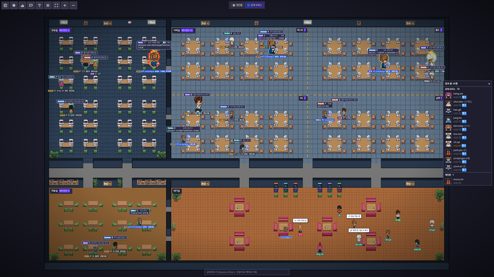

<h1 align="center">Pixel Office</h1>

  <b>한국어</b> · <a href="README.en.md">English</a>

  AI 코딩 에이전트가 픽셀 사무실의 캐릭터가 되어 일하는 모습을 보여 주는 앱입니다. 
  혼자 써도 되고, 팀이나 다른 사람들과 같이 봐도 됩니다.

  <a href="https://yoojungyu.github.io/pixel-office/"><b>📖 사용 설명서 (GitHub Pages)</b></a> ·
  <a href="https://yoojungyu.github.io/pixel-office/architecture.html">기술 구조</a> ·
  <a href="https://github.com/YOOJUNGYU/pixel-office/releases/latest">⬇️ 설치 파일 받기</a> ·
  <a href="docs/설치-안내.md">설치 안내</a>

사용법, 상태별 모습, 토큰 사용량, 오피스 종류, 보안과 개인정보, 동작 방식, 알려진 한계, 개발 방법은 모두 **[사용 설명서](https://yoojungyu.github.io/pixel-office/)** 에 있습니다. 사용한 기술과 전체 구조, 빌드와 배포 과정은 **[기술 구조](https://yoojungyu.github.io/pixel-office/architecture.html)** 페이지를 보세요.

사이트 원본은 [`site/`](site/)에 있고, `main`에 push하면 [Pages 워크플로](.github/workflows/pages.yml)가 다시 올립니다.

## 크레딧

- 원작: [pixel-agents](https://github.com/pixel-agents-hq/pixel-agents) (MIT). 사무실 엔진, 레이아웃 편집기, 가구 그림, 옷장(캐릭터 렌더러와 옷 그림, 눈 깜빡임)을 가져왔습니다.
- 캐릭터: [JIK-A-4, Metro City](https://jik-a-4.itch.io/metrocity-free-topdown-character-pack)
- 토큰 사용량: [token-dashboard](https://github.com/nateherkai/token-dashboard) (MIT)의 아이디어와 집계 방식을 참고했습니다.
- 글꼴: [Pretendard](https://github.com/orioncactus/pretendard) (SIL OFL 1.1)

## 라이선스

[MIT](LICENSE). 원작 pixel-agents의 저작권 표기를 그대로 둡니다.
